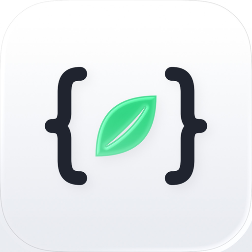

<p align="center"></p>

# Apelin

An on-device IDE for jailbroken iOS and iPadOS 16.0 or later. A code editor,
a terminal and an agent that writes, builds, packages, installs and debugs
tweaks, apps, command-line tools and preference bundles on the device
itself — no Mac in the loop.

Apelin is part of the OwnGoal series and is named after the exercise-induced
peptide hormone.

> **Status:** 0.1.0, the first public release. The whole chain — toolchain
> setup, SDKs, projects, build, sign, package, install, respring and a check
> that the tweak loaded — runs on device, and every step can also be driven
> headless through the [console](Documents/Console.md).

## What it does

- **A real toolchain on the device.** Apelin downloads Apple's Command Line
  Tools package itself (no Xcode, no Apple ID), unpacks it and retargets the
  compilers to iOS on the device. Nothing Apple ships is redistributed.
  C, C++ and Objective-C come with every supported release; Swift is
  optional. [Compatibility](Documents/Compatibility.md) lists the releases,
  CPUs and OS versions each one runs on.
- **An SDK manager.** iPhoneOS SDKs are downloaded from
  [owngoal-dev/iOS-SDKs](https://github.com/owngoal-dev/iOS-SDKs) or another
  source you add, or imported from a file; each is checked and identified
  before it is registered.
- **Projects from templates.** The development extensions bring templates
  for tweaks, UIKit apps, command-line tools and preference bundles. An
  empty workspace takes any build system you bring.
- **Build, sign, package, install.** Builds run under the registered
  toolchain and SDK, are signed in process (byte for byte what
  `ldid -S` writes), packaged as a `.deb` and installed through Irisin's
  daemon.
- **Diagnostics.** The live log, crash reports with symbolication against
  your own builds' dSYMs, screenshots, the UI tree and UI actions, and a
  load check that watches for the tweak's marker across a respring.
- **An agent.** It edits the project, builds, installs, reads logs and
  crashes and uses git, with every step shown as it happens. It signs in to
  GitHub Copilot, Claude, ChatGPT Codex, OpenRouter and many other
  subscription and API-key providers. In *Strict* mode anything beyond a
  project edit or a read-only preset waits for your approval.
- **A terminal and git.** A full terminal (libghostty) in the project, and
  git over HTTPS (libgit2) with a token per host kept in the keychain.
- **Transfer files.** A toolchain, an SDK or a project moves to your other
  device as one file, checked again on arrival.

## Requirements

- A jailbroken iPhone or iPad on iOS / iPadOS 16.0 or later, with a
  **roothide** (`iphoneos-arm64e`) or **rootless** (`iphoneos-arm64`)
  bootstrap.
- [Irisin](https://github.com/Lakr233/Irisin) 4.7.3 or later, whose daemon
  installs the packages Apelin builds.
- A compiler-capable CPU: A12 or later for C, C++ and Objective-C; Swift
  depends on the release (see [Compatibility](Documents/Compatibility.md)).

## Install

Add the OwnGoal Studio repository in your preferred package manager:

**[apt.owngoal.dev](https://apt.owngoal.dev/)**

Every package comes as a roothide (`iphoneos-arm64e`) and a rootless
(`iphoneos-arm64`) deb, there and on
[GitHub Releases](https://github.com/owngoal-dev/Apelin/releases).

- **Apelin** (`wiki.qaq.apelin`) — the IDE itself. It brings Irisin, Fila,
  iGhostVT and icli (`com.icli.icli`, the device tool the agent drives)
  with it, and depends on no injection framework.
- **Development extensions** add project templates. They are recommended
  packages; Apelin also works without them:
  - `wiki.qaq.apelin.dev.app` — UIKit apps in Objective-C, or Swift with
    the toolchain's Swift component
  - `wiki.qaq.apelin.dev.tweak` — tweaks; depends on an injection framework
  - `wiki.qaq.apelin.dev.cli` — command-line tools in C or Objective-C
  - `wiki.qaq.apelin.dev.preferences` — preference bundles
- **Agent tool extensions** add optional tools. Install the ones you need;
  each runs in its own process and includes its licenses:
  - `wiki.qaq.apelin.agent-tools.disassembler` — disassembly and symbols,
    on Capstone
  - `wiki.qaq.apelin.agent-tools.assembler` — assembly, on Keystone
    (GPL-2.0); its corresponding source is published beside it in each
    release

## How it works

The app runs as `mobile`. The privileged half is `apelind`, a launchd job
that starts on demand and exits when idle. It authenticates the app by
audit token, entitlements and the executable on disk before it decodes a
single request, and forwards a closed list of typed operations — none of
them "run this command" — to a session host. The session host keeps every
long task on disk, so a build or an install survives the app going away,
and hands work to small workers (environment, build, agent, diagnostics),
most of which drop to `mobile` before they run.

If the daemon is not installed, the app still works under its own OS
permissions. [AGENTS.md](AGENTS.md) records every design decision in
detail; [CHECKLIST.md](CHECKLIST.md) is the list they came from.

## Building from source

You need a Mac with the newest Xcode (the project tracks the iOS 27 SDK),
plus `dpkg`, `ldid` and `zstd` for packaging and, before committing Swift,
`swiftformat`. Install them with your preferred package manager. There is
no Simulator build: the app runs on devices only.

```sh
make harness        # host tests on the Mac; run this first
make check          # project, packaging, string and accessibility gates
make build          # unsigned app, daemon and workers for iPhoneOS
make deb-all        # roothide and rootless debs, then every extension
make install DEVICE_HOST=<address> DEVICE_PORT=22 FLAVOR=roothide
```

`make help` lists the rest. Packages are ad-hoc signed with `ldid`, so no
developer account is needed; to sign from Xcode, copy
`Configuration/Developer.xcconfig.example` to `Configuration/Developer.xcconfig`
(ignored by git). `make install` copies the package to the device over SSH
and installs it through Irisin's installer.

## Repository layout

```
Apelin/          the app (UIKit)
Apelind/         the daemon and its session host
Workers/         the workers the session host spawns
Packages/        the Swift packages everything is built from
Extensions/      development templates and agent tool extensions
Shared/          what the app and the daemon both compile
Packaging/       entitlements, launchd plist, maintainer scripts
Scripts/         packaging, the device harness and the gates
Documents/       design notes, schemas, console scripts, release notes
Licenses/        reviewed third-party notices
```

## Contributing

Issues and pull requests are welcome. Before opening one, run
`make harness` and `make check`, and `make format` if you touched Swift.
New or corrected project templates are pull requests against
`Extensions/Development/`; the formats are in
[Documents/Schemas](Documents/Schemas/README.md).

## Privacy

Agent and git credentials are stored in the keychain, on this device only,
and never synchronised. Apelin has no telemetry: a conversation goes only
to the model provider you signed in to, and a transfer file only where you
share it.

## License

Apelin is released under the MIT License; see [LICENSE](LICENSE).

Third-party components keep their own licenses. Their notices are in
[Licenses/](Licenses/) and are shown in the app under Settings ▸ Open Source
Licenses.
The assembler extension links Keystone and is distributed under GPL-2.0.
Apple's Command Line Tools and iPhoneOS SDKs remain Apple's, under Apple's
terms; Apelin never ships them. The SDK repository credits
[xybp888/iOS-SDKs](https://github.com/xybp888/iOS-SDKs), from which it was
forked.
